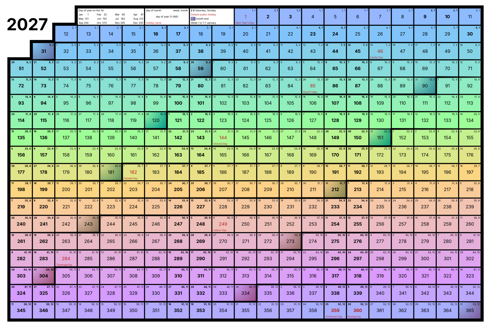

# Yearly calendar

This tool draws a wall calendar for any year. All 365 days sit in one grid, on a poster 60 × 40 in (152 × 102 cm).



Each run makes three files:

- a PNG, 18000 × 12000 px at 300 dpi
- a PDF that stays sharp at any size
- an SVG you can edit

After the [setup steps](#set-up), run it from the repo folder:

```sh
.venv/bin/yearly_calendar 2027
```

Each year gets its own folder in `output/`. Test runs go in folders of their own, so the print files stay safe:

```
output/
└── 2027/
    ├── 2027_Yearly_Calendar.pdf      the file to print
    ├── 2027_Yearly_Calendar.png
    ├── 2027_Yearly_Calendar.svg      the file to edit
    ├── previews/                     runs with --preview
    └── variants/
        └── by_month/                 runs with --preset, --config or --set
```

[`docs/design.md`](docs/design.md) explains why the poster looks the way it does.

## Commands

| Goal | Command |
|---|---|
| Make two years | `.venv/bin/yearly_calendar 2027 2028` |
| Take a quick look | `.venv/bin/yearly_calendar 2027 --preview` |
| Try a preset | `.venv/bin/yearly_calendar 2027 --preset by_month` |
| Change one setting | `.venv/bin/yearly_calendar 2027 --set grid.cell_width=180` |
| Use your own settings file | `.venv/bin/yearly_calendar 2027 --config my_settings.toml` |
| Save to another folder | `.venv/bin/yearly_calendar 2027 --out ~/Downloads` |

Leap years work too. In 2028 the grid grows to 366 boxes.

## Holidays and your own dates

Public holidays print in red. The day number turns red. The name sits in the bottom-left corner. The poster shows Ontario's holidays by default. For England's, use the preset:

```sh
.venv/bin/yearly_calendar 2027 --preset england
```

The dates come from the [`holidays`](https://github.com/vacanza/holidays) package. It covers about 200 countries and their regions. Its README lists the codes. Pick a place in your settings file:

```toml
[holidays]
country = "GB"            # "" turns holidays off
subdivision = "ENG"       # "" for the whole country
observed = true           # when a holiday falls on a weekend, also mark the weekday off
label = "England bank holiday"    # the holiday line in the white tiles
```

A long name wraps onto a second line and crowds the day number. Give it a shorter name:

```toml
names = { "Thanksgiving Day" = "Thanksgiving" }
```

Your own dates print in navy:

```toml
[my_dates]
dates = [
  { date = "07-12", text = "Mum" },                                    # every year
  { date = "2027-08-02", until = "2027-08-09", text = "Japan trip" },  # one trip
]
```

## Change the look

`calendar.toml` holds every setting, with a note on each line. Lengths are in points: 72 pt = 1 inch.

Your own file lists the lines you want to change:

```toml
# my_settings.toml
[grid]
cell_width = 180

[[colors.stops]]
at = "01-01"
color = "#ffd6e0"

[[colors.stops]]
at = "12-31"
color = "#c3f0ff"
```

| To change | Edit |
|---|---|
| The colours | `[[colors.stops]]`: a colour at a date (`"MM-DD"`) |
| How often the colour shifts | `colors.by`: `"day"`, `"week"` or `"month"` |
| Box size | `grid.cell_width`, `grid.cell_height` |
| Boxes in each row | `grid.columns` |
| The steps at the top left | `grid.staircase` |
| Line widths | `lines.cell_border`, `lines.frame`, `lines.month_divider` |
| The dark corner on each month's last day | `[highlight]` |
| What each corner shows | `labels.centre`, `labels.top_left`, `labels.top_right` |
| How weeks are counted | `labels.week_numbering`: `"blocks"` or `"iso"` |
| Bold weekends | `weekends.bold` |
| The white tiles | `overview.show`, `legend.show`, `key.show` |
| The title | `[title]` |
| Poster size | `page.width`, `page.height`, or `"auto"` to fit the calendar |

## Presets

A preset is a small settings file in `presets/`. Repeat `--preset` to use more than one.

| Preset | What it does |
|---|---|
| `original_exact` | Uses the 2026 poster's hand-picked colours |
| `by_month` | Gives each month one colour |
| `iso_weeks` | Counts weeks from Monday to Sunday |
| `square_cells` | Draws square boxes with thinner lines |
| `england` | Shows England's bank holidays |

## Folders

| Folder | What is in it |
|---|---|
| `src/yearly_calendar/` | The code |
| `assets/` | Number and letter shapes from the font Inter |
| `tools/` | The scripts that made those shapes |
| `presets/` | Ready-made settings |
| `tests/` | The tests |
| `docs/` | The preview, the design notes and the writing rules |

## Set up

The tool runs on Python 3.11 or newer. It uses the Cairo library to draw.

```sh
git clone https://github.com/Naragod/calendar.git
cd calendar
brew install cairo                # Debian or Ubuntu: sudo apt install libcairo2
python3 -m venv .venv
.venv/bin/pip install -e '.[dev]'
.venv/bin/python -m pytest
```

Install with `-e`. The tool reads its settings and shapes from the repo folder.

## License

The code uses the [MIT License](LICENSE). The shapes in `assets/` come from [Inter](https://github.com/rsms/inter), under the [SIL Open Font License 1.1](assets/Inter-OFL.txt).
